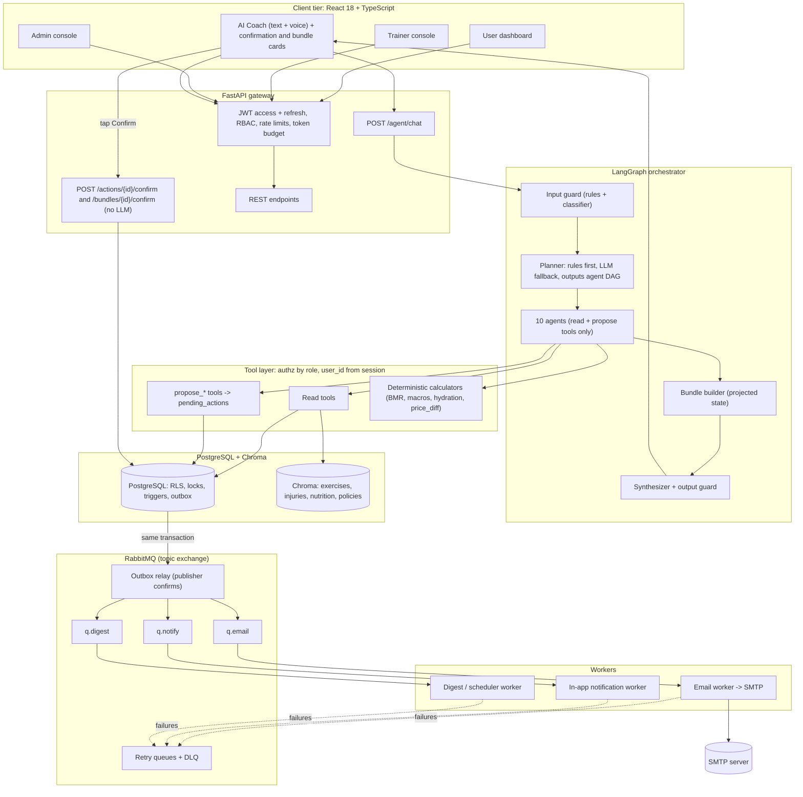

# 00 CORE: read this before every phase

Project: GymPro AI. Full specification: `docs/GYMPRO_SPEC.md` (keep a copy there). Any section number mentioned below that is not included in a phase file can be found in that file by heading.

These core sections apply to every phase. Phase files in this folder add the sections and tasks for one phase only.

## 0. Agent build brief (read this first)

**Audience:** an autonomous coding agent (Google Antigravity) building GymPro AI from scratch in an empty workspace. **This single file is the whole specification.** There is no earlier code, archive or version to consult. If something is not here, choose the simplest option consistent with sections 3, 5 and 12, and log it in `docs/DECISIONS.md`.

### 0.1 How to read this file

This file is long. Do not load it blindly into every step.

1. Read sections **0, 2, 3 and 5** fully before writing any code.
2. For each phase in section 19, read **only the sections that phase lists**. Find them by heading.
3. Precedence when two places disagree (highest first):
   1. Design rules (5.2) and security controls (12)
   2. SQL in section 6 (the schema is authoritative; copy it into `backend/db/schema.sql` in the order shown)
   3. Prompt text in section 7 (copy verbatim into `backend/prompts/`, one file per prompt)
   4. Behavior described in prose (sections 3, 4, 9, 11)
   5. Code in sections 8 and 10. It is **reference code**: it shows interfaces and intent, omits some imports and helpers (for example `guards`, `escalate_node`, `skipped_envelope`), and is condensed. Complete it properly. If it breaks a rule from level 1, the rule wins and you fix the code.
4. Resolve every ambiguity yourself and add one line to `docs/DECISIONS.md`. Do not stop to ask.

### 0.2 Operating rules for the build agent

1. **Work phase by phase** (section 19). Before each phase write a short plan and task list. After it, run the phase gate. Do not start the next phase until the gate passes. Run `git init` first and commit once per phase.
2. **No Docker, no containers.** Install everything natively. Primary platform: Windows 10/11 with PowerShell. Keep commands portable to macOS and Linux where it costs nothing. Python 3.11+, Node 20+, PostgreSQL 15+, RabbitMQ 3.12+, Mailpit (single binary). Ollama is optional.
3. **Configuration and secrets only from environment variables.** Read them through `pydantic-settings` from `.env`. Commit `.env.example`; never commit `.env`. The only literal passwords allowed in the repo are the dev placeholder `change-me` in `.env.example` and the role bootstrap SQL.
4. **Safety rules are tests, not suggestions.** Never weaken, skip or delete a security or safety test to make a gate pass. Fix the code.
5. **Tests never call a real LLM.** Build a `FakeLLM` that returns scripted JSON and malicious tool calls. Real-model evals are optional and marked `@pytest.mark.live`. Tests, evals and demo fixtures freeze the clock at `2026-10-16T18:05:00+05:30` (a Friday).
6. **LLM output is never trusted:** it cannot reach SQL, shell commands, email recipients or unescaped templates.
7. **Every phase ends** by updating `README.md` (how to run) and `docs/PROGRESS.md` (phase, gate result, known gaps).
8. **Test infrastructure:** a separate database `gympro_test`, a pytest fixture that applies `backend/db/schema.sql` once per session and truncates between tests, and real PostgreSQL for every concurrency, RLS and trigger test (no SQLite, no mocks for those).

### 0.3 Locked decisions (final, do not reopen)

| # | Topic | Decision |
| :-- | :--- | :--- |
| 1 | Role name | `USER`, `TRAINER`, `ADMIN` |
| 2 | Agents | 10 agents (SCHEDULE, MEMBERSHIP, FITNESS, WELLNESS, NUTRITION, TRAINER_INFO, SUPPORT, COMMS, TRAINER_OPS, ADMIN_INSIGHTS) plus a Supervisor made of input guard, planner, bundle builder and synthesizer |
| 3 | Writes | Each agent proposes at most **one write per step**. The server groups steps into one bundle card. Max **5** write steps per bundle (`bundle_max_steps`) |
| 4 | Planner | Plan is a DAG with `depends_on`. Max **4 waves**, max **6 agents**. Rules fast path first, LLM fallback. Agents inside a wave run **sequentially** in v1 |
| 5 | Orchestration | LangGraph `StateGraph` **without a checkpointer** in v1. The human-in-the-loop boundary is the database (`pending_actions`, `action_bundles`), not a graph interrupt |
| 6 | Notifications | Templates are deterministic and system-owned. COMMS only proposes user-requested email to the user's **own verified address**. Delivery path: outbox, RabbitMQ, worker, SMTP |
| 7 | Admin copilot | ADMIN_INSIGHTS uses the metric catalog only (no free SQL). It may propose admin actions. It **can never act on admin-role requests** |
| 8 | Member data | `member_profiles` (current state) plus append-only `member_intake_versions` |
| 9 | Account state | `account_status` only (no `is_active`). Login succeeds only when `ACTIVE` |
| 10 | Tokens | Access JWT (RS256, 15 min) plus opaque refresh token (7 days) with rotation and reuse detection |
| 11 | Trial | 3 classes within 14 days, once per person. Checked at proposal and again at execution |
| 12 | Payments | **Razorpay** (Orders API plus Checkout) behind a provider adapter, test keys in development, live keys in production. A `mock` mode (instant success) exists for tests and keyless demos and is refused in production. Details in section 8.15 |
| 13 | Downgrades | Staff-handled at renewal. No downgrade tool in v1 |
| 14 | Bundles | Not atomic across steps. Each step runs in its own transaction. A failed step skips its dependents; independent steps still run |
| 15 | Admin activation | One-time code goes to **every** active admin. Any one may share it (no quorum). Cooling-off 24 h. Admin MFA is recommended, not required, in v1 |
| 16 | Staff invites | **TRAINER invites only**, from the dashboard (and through ADMIN_INSIGHTS as a proposal). **ADMIN invites do not exist in v1.** The only ways to become ADMIN are the seed command and the one-time-code flow. An accepted trainer invite creates an `APPROVED` `role_requests` row (`decided_by` = inviter) in the same transaction that sets the role, so the role-change trigger is satisfied |
| 17 | Unverified trainers | Their classes stay visible without credentials. `require_verified_trainer_for_publish` defaults to `false` |
| 18 | Reports to admin | The trainer is never contacted and never told who reported |
| 19 | Voice | Browser speech APIs (speech to text, text to speech). Voice never confirms an action |
| 20 | Rate limiting | An in-process limiter behind a small interface (`check(key, limit, window_s)`) so Redis can replace it later. Fine for a single API worker |
| 21 | Vector store | ChromaDB persistent client with its default embedding function (the first run downloads a small model). KB content is the starter corpus described in section 11 |
| 22 | Currency | Seed plans use **INR** (Silver 999, Gold 1999, Platinum 3499 per month). Money is stored as `NUMERIC` and sent to Razorpay as integer paise. Code must never assume a currency |
| 23 | Database migrations | One authoritative `backend/db/schema.sql` plus `backend/db/seed_dev.sql`. No Alembic in v1 |
| 24 | Money rules | One payment per action; `finalize_paid` is the only place a paid change activates; refunds are issued by staff in the Razorpay dashboard and recorded from webhooks; renewals are user-initiated (no auto-debit in v1) |

### 0.4 Definition of done (whole project)

- All phase gates in section 19 pass from a clean checkout using only the commands in section 15.
- The five-minute demo script (1.5) can be run end to end by hand, against Mailpit and a local or fake LLM.
- Every safety eval and every security test in sections 12 and 13 passes at 100%.
- No agent has a write tool. No endpoint or tool accepts `user_id` or a recipient address from the client or the LLM.
- `README.md` lets a new developer run everything on Windows in under 30 minutes.

### 0.5 Phase kickoff prompt (paste into Antigravity for each phase)

```text
Open GYMPRO_SPEC.md. Read sections 0, 2, 3 and 5 first, then the sections listed for Phase <N> in section 19.
Write a short plan and task list, then implement Phase <N> completely, including its tests.
Run the phase gate exactly as written. If it fails, fix the code (never the safety tests) and re-run.
When it passes: update README.md and docs/PROGRESS.md, commit, and stop. Do not start Phase <N+1>.
```

---

## 2. System overview and technology matrix

| Layer | Technology | Notes |
| :--- | :--- | :--- |
| **Frontend** | React 18 + TypeScript (Vite, Tailwind, TanStack Query, Lucide) | Three role consoles, AI Coach drawer, confirmation and bundle cards, accessible chat |
| **Backend** | Python 3.11+ (FastAPI, Pydantic v2, SQLAlchemy 2.0 async, asyncpg) | REST + SSE. Pydantic is the single contract language for tools and agent outputs |
| **Auth** | PyJWT (RS256 access token), bcrypt, opaque refresh tokens | Role and status re-read from the database on every request |
| **Database** | PostgreSQL 15+ | Row locks, advisory locks, exclusion constraints, JSONB, RLS, triggers |
| **Vector DB** | ChromaDB persistent client (embedded, SQLite + HNSW on disk) | Collections: `exercises`, `injury_protocols`, `nutrition_science`, `gym_policies` |
| **LLM gateway** | Adapter over Azure OpenAI / OpenAI / Ollama | `AsyncAzureOpenAI` for Azure; OpenAI-compatible `base_url` for Ollama. Output always re-validated with Pydantic |
| **Orchestration** | LangGraph (`StateGraph`, no checkpointer in v1) | Typed state and waves. The confirmation boundary is the database (`pending_actions`, `action_bundles`), so no graph interrupt or checkpointer is needed |
| **Messaging** | RabbitMQ (topic exchange, DLX, retry queues) via `aio-pika` | Transactional outbox, publisher confirms, manual acks |
| **Email** | SMTP via `aiosmtplib`. Dev: Mailpit (local binary). Prod: provider with SPF, DKIM, DMARC | Transactional separate from marketing |
| **Payments** | Razorpay Orders API and Checkout.js via `httpx`, behind a `PaymentProvider` adapter (`mock` for tests) | Amounts in paise, HMAC-verified signatures and webhooks, idempotent finalization, reconciler job. See section 8.15 |
| **Observability** | OpenTelemetry + structured JSON logs (+ Langfuse or Phoenix optional) | Trace per request: prompt versions, tool calls, tokens, latency, validator results |
| **Voice** | Browser Web Speech API for speech-to-text and `speechSynthesis` for text-to-speech | **Not offline** in Chrome and Edge (audio goes to the vendor). Swap to a local Whisper endpoint for offline |

**Processes** (each is a separate OS process, no containers needed):

| Process | Responsibility |
| :--- | :--- |
| `api` | FastAPI app: auth, REST, `/agent/chat`, confirm endpoints |
| `outbox-relay` | Reads `notification_outbox`, publishes to RabbitMQ with confirms |
| `email-worker` | Consumes `q.email`, renders templates, sends SMTP, writes `email_log` |
| `notify-worker` | Consumes `q.notify`, writes in-app `notifications` |
| `digest-worker` | Consumes `q.digest` and runs the scheduler (daily digest, reminders, expiry jobs, **payment reconciliation every minute**) |
| `agent-async-worker` (optional) | Consumes `q.agent.async` for long agent jobs |

---

## 3. Roles, capabilities and data access

### 3.1 Capability matrix

| Capability | USER | TRAINER | ADMIN |
| :--- | :---: | :---: | :---: |
| Register (self sign-up) | Yes, active after email verification | Yes, **active only after an admin approves** | Yes, **active only after typing a one-time code sent to the existing admins** (disabled when no admin exists) |
| Log in with email + password | Yes | Yes | Yes |
| Forgot / reset password | Yes | Yes | Yes |
| Free trial (limited free classes) | Yes | | |
| Browse classes, trainers, plans | Yes | Yes | Yes |
| Book, waitlist, cancel own sessions | Yes | | |
| Buy / upgrade membership | Yes | | Grant on request |
| Intake profile, fitness, wellness, nutrition guidance | Yes | | |
| Talk to AI Coach (text or voice) | Yes | TRAINER_OPS | ADMIN_INSIGHTS |
| Report a problem (class, trainer, facility) | Yes | | Triage |
| Set availability days, time off, class restrictions | | Yes | Override |
| Create single / recurring classes | | Own only | Any trainer |
| View rosters, mark attendance | | Own classes | All |
| Business overview, anomalies, digests | | | Yes |
| Verify trainers, invite staff, broadcast announcements | | | Yes |
| Approve or reject trainer requests | | | Yes |
| Approve admin requests | | | **Never through an agent or the dashboard.** Only the one-time-code flow exists; the dashboard can reject or revoke |

### 3.2 Data access rules (enforced in the tool layer and by RLS, never by prompts alone)

| Role | May read | May never read |
| :--- | :--- | :--- |
| USER | Own profile, bookings, membership, intake, logs, nutrition plans, notifications | Anyone else's data, aggregates beyond public catalog |
| TRAINER | Own classes, rosters (attendee **first names** only), own availability, aggregated feedback | Attendee health data, other trainers' classes, revenue |
| ADMIN | Aggregates from the metric catalog (k-anonymity floor), issue queue, trainer requests, users' account metadata needed for support | **Individual health data, intake, per-member attendance**, through any agent |

**The role is always read from the database on every request, never from the token or from AI output.**

---

## 5. Architecture, design rules and request lifecycle

### 5.1 Architecture



### 5.2 Non-negotiable design rules

1. **LLMs never write to the database.** They create proposals; humans confirm; deterministic code executes inside a transaction.
2. **Identity is never inferred from text.** `user_id`, `role`, `tier`, `timezone`, `locale`, `account_status` come from the verified JWT and are re-read from the database. Tools never accept `user_id` from the LLM.
3. **Every fact comes from a tool result.** No tool result means no claim.
4. **Every number comes from a calculator.** The LLM explains numbers; it does not produce them.
5. **Every agent output is schema-validated** and retried once with the validation error; otherwise a safe fallback is returned.
6. **Safety precedence is fixed:** Health constraints > Fitness plan > Schedule > Nutrition > Membership > Marketing.
7. **Every run is traceable:** prompt versions, tool calls and validator results are stored in `agent_runs` and `agent_tool_calls`.
8. **Prompts are versioned artifacts** (semver, changelog, eval gate in CI), not strings in code.
9. **Bundles are built by the server.** The client cannot send steps. Every step is re-validated at execution, in order.
10. **A failed step skips its dependents.** Independent steps still run.
11. **Agents can only email the user's own verified account address.** No free-form marketing.
12. **Privilege changes only through `role_requests`.** Admin requests are never approvable by an agent.
13. **Safety paths work without an LLM.** Guards, escalation and refusal are deterministic so an LLM outage cannot disable them.
14. **Money moves only through the payment adapter, after a tap on Confirm.** Agents never see card, UPI or bank data. A paid change becomes real only in `finalize_paid` after server-side signature verification (section 8.15).

### 5.3 Request lifecycle

| Phase | Component | LLM? | Output |
| :--- | :--- | :---: | :--- |
| 1 | Auth, rate limit, token budget | No | `SessionContext` (identity, role, plan, locale, timezone, consent, minor flag, account status) |
| 2 | Input guard (regex hints + classifier) | Optional | Labels, route (CONTINUE, ESCALATE, REFUSE, CLARIFY) |
| 3 | Planner (rules fast path, LLM fallback) | Fallback only | Plan: intents, DAG of agents, handoffs, at most one clarification |
| 4 | Agent waves in dependency order | Yes | Validated envelopes; propose tools create `pending_actions` rows |
| 5 | Bundle builder | No | `action_bundles` row with ordered steps; projected state passed forward during planning |
| 6 | Synthesizer + output guard | Light | One reply, `quick_actions` that exist, scrubbed PII |
| 7 | User taps Confirm | No | Executor runs steps in order, re-checking everything |
| 8 | Outbox relay, RabbitMQ, workers | No | Emails, in-app notices, audit |

---

### 19.2 Required repository files (checklist)

`README.md`, `.env.example`, `.gitignore`, `docs/DECISIONS.md`, `docs/PROGRESS.md`, `scripts/gen_keys.py`, `backend/db/schema.sql`, `backend/db/seed_dev.sql`, `backend/app/**` (8.2), `backend/prompts/**` (7.1) with `CHANGELOG.md`, `backend/kb/corpus/**` (11), `backend/tests/**`, `frontend/**`.

---

### 19.3 Final acceptance

The project is complete when a fresh clone, following only section 15, reaches a state where: a user registers and verifies by email in Mailpit; completes intake with consent; asks the Coach the flagship message from 4.8 and confirms one bundle card; receives the booking email; and an admin approves a trainer request. The flagship upgrade also works through Razorpay test-mode Checkout (`PAYMENTS_MODE=razorpay`), all with the safety and security suites green.
