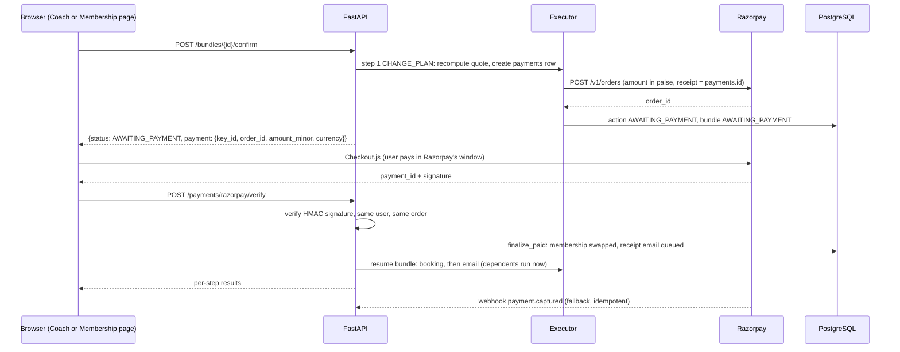

# Phase P6b: Payments (Razorpay)

**Before you start:** read `prompts/00_CORE.md` (rules, locked decisions, architecture). Previous phases must already pass their gates.

## Task
Write a short plan and task list, then implement this phase completely, including its tests. Resolve ambiguities yourself and log each in `docs/DECISIONS.md`. Never weaken or skip a safety or security test.

## Deliverables
`payments` and `payment_events` tables (already in the schema), `PaymentProvider` adapter with `RazorpayProvider`, `MockProvider` and a test `FakeProvider`; `payments.begin`, `finalize_paid`, `finalize_unpaid`; verify, webhook, status and cancel endpoints; reconciler in the digest worker; bundle pause and resume; receipt and review emails; production startup check

## Gate (must pass before you stop)
`pytest tests/payments -q` passes every row of the test table in 8.15, and the P6 executor tests still pass in `mock` mode

## When the gate passes
Update `README.md` and `docs/PROGRESS.md`, commit once, and stop. Do not start Phase P7.

---

# Spec sections for this phase (copied from the full spec)

### 4.4 Trial, memberships and upgrades

| Item | Rule (all values configurable in `gym_settings`) |
| :--- | :--- |
| Trial | 3 free classes within 14 days of verification, only classes marked `trial_eligible`, no personal-training sessions, once per person |
| After trial | Account stays active but cannot book until a plan is chosen. Friendly, non-pressuring prompt |
| Plans | SILVER, GOLD, PLATINUM. Prices and perks live only in `membership_plans` |
| Perk examples | Class credits per month or unlimited, PT sessions, nutrition consultation, spa, priority booking window |
| Upgrade | Choose a higher plan. **The old membership is ended and replaced.** Prorated charge shown before confirming |
| Payment | After the user confirms, the app opens a secure **Razorpay Checkout** window for the prorated amount. The plan changes only after the payment is verified by the server (section 8.15) |
| Downgrade | Takes effect at renewal, handled by staff in v1 |
| "Highest plan" | Resolved by the tool `get_highest_plan` as the plan with the greatest `sort_order`, then shown to the user for confirmation |
| Entitlement order | Active membership credits first; trial grant only when no active membership and the class is trial eligible |

**Seed plans** (INR; prices come from the table at runtime):

| Plan | Price / month | Group classes / month | PT sessions / month | Nutrition consult | Spa |
| :--- | :--- | :--- | :--- | :--- | :--- |
| SILVER | 999.00 | 4 | 0 | No | No |
| GOLD | 1999.00 | Unlimited | 2 | No | No |
| PLATINUM | 3499.00 | Unlimited | 5 | Yes | Yes |

---

### 6.8 Pending actions and bundles (the confirmation boundary)

```sql
CREATE TABLE action_bundles (
    id          UUID PRIMARY KEY DEFAULT gen_random_uuid(),
    user_id     UUID NOT NULL REFERENCES users(id) ON DELETE CASCADE,
    run_id      UUID,
    status      bundle_status NOT NULL DEFAULT 'PENDING',
    summary     TEXT NOT NULL,                            -- card headline
    expires_at  TIMESTAMPTZ NOT NULL,
    created_at  TIMESTAMPTZ NOT NULL DEFAULT NOW(),
    executed_at TIMESTAMPTZ
);

CREATE TABLE pending_actions (
    id            UUID PRIMARY KEY DEFAULT gen_random_uuid(),
    user_id       UUID NOT NULL REFERENCES users(id) ON DELETE CASCADE,   -- the actor (any role)
    run_id        UUID,
    bundle_id     UUID REFERENCES action_bundles(id) ON DELETE CASCADE,
    step_no       SMALLINT,                                -- 1-based order inside a bundle
    depends_on    SMALLINT[] NOT NULL DEFAULT '{}',        -- step numbers that must be EXECUTED first
    type          action_type NOT NULL,
    payload       JSONB NOT NULL,                          -- validated by Pydantic before insert
    projected     JSONB,                                   -- effects used by later steps (plan after upgrade, etc.)
    summary       TEXT NOT NULL,                           -- human-readable, shown on the confirm card
    status        action_status NOT NULL DEFAULT 'PENDING',
    result        JSONB,
    expires_at    TIMESTAMPTZ NOT NULL,
    created_at    TIMESTAMPTZ NOT NULL DEFAULT NOW(),
    executed_at   TIMESTAMPTZ,
    CONSTRAINT chk_bundle_step CHECK ((bundle_id IS NULL AND step_no IS NULL) OR (bundle_id IS NOT NULL AND step_no IS NOT NULL)),
    UNIQUE (bundle_id, step_no)
);
CREATE INDEX idx_pending_user ON pending_actions (user_id, status, expires_at);

-- Payments (Razorpay). Money in minor units (paise for INR). No card or UPI data is ever stored.
CREATE TABLE payments (
    id                  UUID PRIMARY KEY DEFAULT gen_random_uuid(),
    user_id             UUID NOT NULL REFERENCES users(id) ON DELETE RESTRICT,   -- financial records are kept; accounts are soft-deleted
    action_id           UUID NOT NULL UNIQUE REFERENCES pending_actions(id),     -- one payment per confirmed action
    provider            VARCHAR(12) NOT NULL CHECK (provider IN ('RAZORPAY','MOCK','NONE')),
    purpose             VARCHAR(20) NOT NULL DEFAULT 'PLAN_CHANGE',              -- PLAN_CHANGE | PLAN_RENEWAL
    amount_minor        BIGINT NOT NULL CHECK (amount_minor >= 0),
    currency            CHAR(3) NOT NULL,
    status              payment_status NOT NULL DEFAULT 'CREATED',
    razorpay_order_id   VARCHAR(40) UNIQUE,
    razorpay_payment_id VARCHAR(40) UNIQUE,
    quote               JSONB NOT NULL,                                          -- from_plan, to_plan, cycle, prorated total, next_billing_date
    membership_id       UUID REFERENCES memberships(id),                         -- set when activated
    attempts            INT NOT NULL DEFAULT 0,                                  -- payment.failed events seen
    refunded_minor      BIGINT NOT NULL DEFAULT 0 CHECK (refunded_minor >= 0),
    failure_code        VARCHAR(40),
    expires_at          TIMESTAMPTZ NOT NULL,
    created_at          TIMESTAMPTZ NOT NULL DEFAULT NOW(),
    paid_at             TIMESTAMPTZ,
    CONSTRAINT chk_refund_le_amount CHECK (refunded_minor <= amount_minor)
);
CREATE INDEX idx_payments_open ON payments (status, created_at) WHERE status = 'CREATED';
CREATE INDEX idx_payments_user ON payments (user_id, created_at DESC);

-- Webhook deduplication: Razorpay sends a unique event id header with every delivery
CREATE TABLE payment_events (
    event_id    VARCHAR(80) PRIMARY KEY,
    event       VARCHAR(60) NOT NULL,
    order_id    VARCHAR(40),
    payload     JSONB NOT NULL,
    received_at TIMESTAMPTZ NOT NULL DEFAULT NOW()
);
```

---

### 8.9 Deterministic executors

```python
# app/executor/single.py   POST /api/actions/{action_id}/confirm   (no LLM anywhere in this path)
@router.post("/api/actions/{action_id}/confirm")
async def confirm_action(action_id: UUID, s: SessionContext = Depends(get_session), db=Depends(get_db)):
    async with db.begin():
        await set_rls(db, s.user_id, s.role)                              # SET LOCAL app.user_id / app.role
        action = (await db.execute(select(PendingAction).where(PendingAction.id == action_id)
                  .with_for_update())).scalar_one_or_none()
        if not action or str(action.user_id) != s.user_id:
            raise HTTPException(404)
        if action.bundle_id:
            raise HTTPException(409, "This action belongs to a bundle; confirm the bundle")
        if action.status == "EXECUTED":
            return action.result                                           # idempotent replay
        if action.status != "PENDING" or action.expires_at < utcnow():
            raise HTTPException(409, "ACTION_EXPIRED")
        return await run_action(db, s, action)

async def run_action(db, s, action) -> dict:
    handler = HANDLERS[action.type]                                       # one function per action type
    if action.type in ADMIN_ONLY and (s.role != "ADMIN" or s.cooling_off_active):
        result = {"ok": False, "error": "FORBIDDEN"}
    else:
        result = await handler(db, s, action)                             # may return a business error
    if result.get("awaiting"):                                            # payment pending: neither executed nor failed
        action.status, action.result = "AWAITING_PAYMENT", result
        return result
    action.status = "EXECUTED" if result["ok"] else "FAILED"
    action.result, action.executed_at = result, utcnow()
    db.add(AuditLog(actor_id=s.user_id, action=f"EXEC_{action.type}", entity="pending_actions", entity_id=action.id))
    return result
```

```python
# app/executor/handlers.py
async def exec_book(db, s, action):
    p = BookPayload.model_validate(action.payload)
    await db.execute(text("SELECT pg_advisory_xact_lock(hashtextextended(:u, 0))"), {"u": s.user_id})  # no overlapping double-book races
    cls = (await db.execute(select(FitnessClass).where(FitnessClass.id == p.class_id).with_for_update())).scalar_one_or_none()
    if not cls or cls.status != "SCHEDULED" or cls.start_time <= utcnow():
        return {"ok": False, "error": "CLASS_UNAVAILABLE"}
    if not (await class_rules(db, s, cls)).ok:
        return {"ok": False, "error": "RULE_FAILED"}
    if await find_conflicts(db, s.user_id, cls):
        return {"ok": False, "error": "CONFLICT"}
    ent = await entitlements(db, s.user_id, cls)                          # real state now (an upgrade step has already run)
    if not ent.can_book:
        return {"ok": False, "error": "NO_ENTITLEMENT", "detail": ent.reason}
    if cls.booked_count >= cls.capacity:
        return {"ok": False, "error": "CLASS_FULL", "hint": "offer_waitlist"}
    try:
        booking = Booking(user_id=s.user_id, class_id=cls.id, status="CONFIRMED", idempotency_key=action.id,
                          used_trial_grant=ent.trial_grant_id)
        db.add(booking); cls.booked_count += 1
        if ent.source == "TRIAL":
            await db.execute(text("UPDATE trial_grants SET classes_used = classes_used + 1 WHERE id = :g"), {"g": ent.trial_grant_id})
        await db.flush()                                                   # partial unique index catches duplicates
    except IntegrityError:
        return {"ok": False, "error": "ALREADY_BOOKED"}
    await enqueue(db, user_id=s.user_id, routing_key="email.booking", template="CLASS_CONFIRMED",
                  params={"class_id": str(cls.id), "booking_id": str(booking.id)}, dedupe_key=f"confirm:{booking.id}")
    return {"ok": True, "booking_id": str(booking.id), "class_id": str(cls.id)}

async def exec_change_plan(db, s, action):
    p = ChangePlanPayload.model_validate(action.payload)                   # to_plan, cycle, confirmed_total
    await db.execute(text("SELECT pg_advisory_xact_lock(hashtextextended(:u, 1))"), {"u": s.user_id})
    plan = await get_plan(db, p.to_plan)
    if not plan or not plan.is_active:
        return {"ok": False, "error": "PLAN_UNAVAILABLE"}
    quote = await price_diff(db, s.user_id, p.to_plan, p.cycle)            # recomputed now
    if abs(quote.prorated_today - p.confirmed_total) > Decimal("0.01"):
        return {"ok": False, "error": "PRICE_CHANGED", "new_total": quote.prorated_today}
    pay = await payments.begin(db, s, action, quote)                        # section 8.15
    if pay.state == "AWAITING":                                             # Razorpay: the browser must pay first
        return {"ok": None, "awaiting": pay.checkout}                       # action -> AWAITING_PAYMENT, bundle pauses
    if pay.state != "PAID":
        return {"ok": False, "error": pay.error}                            # PAYMENT_PROVIDER_REQUIRED and similar
    return await activate_plan(db, s, p, quote, pay.id)

async def activate_plan(db, s, p, quote, payment_id):
    """Swap the membership. Shared by the mock path and finalize_paid, so there is exactly one implementation."""
    old = await active_membership(db, s.user_id, for_update=True)
    if (old.plan_code if old else None) != quote.from_plan:                 # the user's plan changed since the quote
        return {"ok": False, "error": "CONFLICT"}
    new = Membership(user_id=s.user_id, plan_code=p.to_plan, status="ACTIVE", billing_cycle=p.cycle,
                     price_paid=quote.prorated_today, end_date=quote.next_billing_date)
    if old:
        old.status = "REPLACED"; old.end_date = today(); await db.flush()   # frees uq_one_active_membership
    db.add(new); await db.flush()
    if old:
        old.replaced_by = new.id
    await link_payment_to_membership(db, payment_id, new.id)
    await enqueue(db, user_id=s.user_id, routing_key="email.plan", template="PLAN_CHANGED",
                  params={"plan": p.to_plan}, dedupe_key=f"plan:{new.id}")
    return {"ok": True, "membership_id": str(new.id), "plan": p.to_plan}

async def exec_send_booking_email(db, s, action):
    p = SendEmailPayload.model_validate(action.payload)                    # template_id, params, attach_calendar, requires_step
    to_email = await account_email(db, s.user_id)                          # read at execution: the user's OWN address
    if not await email_cap_ok(db, s.user_id):
        return {"ok": False, "error": "EMAIL_CAP_REACHED"}
    params = dict(p.params)
    if p.requires_step is not None:
        prior = await step_result(db, action.bundle_id, p.requires_step)   # bundle executor guarantees it is EXECUTED
        params["booking_id"] = prior["booking_id"]
    await enqueue(db, user_id=s.user_id, routing_key="email.booking", template=p.template_id,
                  params={**params, "attach_calendar": p.attach_calendar},
                  dedupe_key=f"email:{action.id}")                          # worker resolves the address again from users
    return {"ok": True, "to_masked": mask(to_email)}

async def exec_issue_report(db, s, action):
    p = IssuePayload.model_validate(action.payload)
    if await reports_today(db, s.user_id) >= settings_int(db, "issue_reports_per_day"):
        return {"ok": False, "error": "REPORT_LIMIT_REACHED"}
    if p.class_id and not await user_attended_or_booked(db, s.user_id, p.class_id):
        return {"ok": False, "error": "CLASS_NOT_YOURS"}
    severity = max_severity(p.severity_hint, FLOOR[p.category])            # SAFETY/HARASSMENT/INJURY >= HIGH
    row = IssueReport(reporter_id=s.user_id, class_id=p.class_id, trainer_id=await trainer_of(db, p.class_id),
                      category=p.category, severity=severity, user_words=p.user_words, ai_summary=p.neutral_summary)
    db.add(row); await db.flush()
    key = "issue.urgent" if severity in ("HIGH", "URGENT") else "issue.created"
    await enqueue(db, user_id=None, routing_key=key, template="ISSUE_ADMIN_ALERT", params={"issue_id": str(row.id)},
                  dedupe_key=f"issue:{row.id}")
    await enqueue(db, user_id=s.user_id, routing_key="email.issue", template="ISSUE_RECEIVED", params={}, dedupe_key=f"issue-ack:{row.id}")
    return {"ok": True, "issue_id": str(row.id), "severity": severity}

async def exec_decide_trainer_request(db, s, action):
    p = DecidePayload.model_validate(action.payload)                       # request_id, decision, reason
    req = await get_role_request(db, p.request_id, for_update=True)
    if not req or req.requested_role != "TRAINER" or req.status != "PENDING":   # admin requests never reach here
        return {"ok": False, "error": "REQUEST_NOT_PENDING"}
    req.decided_by, req.decided_at, req.reason = s.user_id, utcnow(), p.reason
    if p.decision == "APPROVE":
        req.status = "APPROVED"; await db.flush()
        await db.execute(text("UPDATE users SET role='TRAINER', account_status='ACTIVE' WHERE id=:u"), {"u": req.user_id})  # trigger satisfied
        await ensure_trainer_profile(db, req)
    elif p.decision == "REJECT":
        req.status = "REJECTED"
        await db.execute(text("UPDATE users SET account_status='REJECTED' WHERE id=:u"), {"u": req.user_id})
    else:
        req.info_requested = p.reason                                        # ASK_INFO keeps the request PENDING
    await enqueue(db, user_id=req.user_id, routing_key="email.trainer_decision", template="TRAINER_DECISION",
                  params={"decision": p.decision, "reason": p.reason}, dedupe_key=f"trainer-decision:{req.id}:{p.decision}")
    return {"ok": True, "decision": p.decision}

HANDLERS = {"BOOK_CLASS": exec_book, "CHANGE_PLAN": exec_change_plan, "SEND_BOOKING_EMAIL": exec_send_booking_email,
            "SUBMIT_ISSUE_REPORT": exec_issue_report, "ADMIN_DECIDE_TRAINER_REQUEST": exec_decide_trainer_request,
            # ... CANCEL_BOOKING, JOIN_WAITLIST, RENEW_PLAN, SAVE_NUTRITION_PLAN, CREATE_CLASS, CREATE_CLASS_SERIES,
            # UPDATE_CLASS_RESTRICTIONS, CANCEL_CLASS, SET_AVAILABILITY, SET_TIME_OFF, ADMIN_* follow the same shape
            }
ADMIN_ONLY = {"ADMIN_VERIFY_TRAINER", "ADMIN_DECIDE_TRAINER_REQUEST", "ADMIN_BROADCAST", "ADMIN_MESSAGE_USER",
              "ADMIN_GRANT_MEMBERSHIP", "ADMIN_INVITE_STAFF", "ADMIN_UPDATE_ISSUE"}
# Note: no handler and no action type exists for approving an admin-role request.
```

Waitlist promotion on cancellation (same transaction as the cancel): lock the class, decrement `booked_count`, pick the oldest `WAITLISTED` booking by `waitlist_seq` with `FOR UPDATE SKIP LOCKED`, re-check that member's entitlement and conflicts (skip ineligible members), promote, increment `booked_count`, enqueue `WAITLIST_PROMOTED`.

---

### 8.15 Payments (Razorpay)

Money moves only after the user taps Confirm, only through the deterministic executor, and only through a provider adapter. Agents never see, collect or discuss card, UPI or bank details. The browser talks to Razorpay Checkout directly, so no payment instrument data ever reaches this system.

**Modes** (`PAYMENTS_MODE`)

| Mode | Behavior |
| :--- | :--- |
| `mock` | Development and most tests. Payment succeeds instantly inside the executor. **The API refuses to start with `ENV=production` and `mock`.** |
| `razorpay` | Real flow with Razorpay **test keys** in development and **live keys** in production. Uses the Orders API and Checkout. |
| `disabled` | Any paid change fails with `PAYMENT_PROVIDER_REQUIRED`. Free actions still work. |

**Flow for a paid plan change (mode `razorpay`)**



**Rules**

1. **Amounts are integers in minor units** (paise for INR). Convert from `Decimal` with `ROUND_HALF_UP`. Never use floats for money.
2. **The quote is re-computed at execution** and must equal the confirmed total, otherwise `PRICE_CHANGED`. The Razorpay order is created for exactly that amount. `price_diff` applies the minimum charge (1.00 INR when the total is above zero), so the card shows what will actually be charged. A zero total skips the provider (`provider = NONE`).
3. **One payment per action** (`payments.action_id` is unique). Replaying confirm returns the same open order. Never create a second order for the same action.
4. **A payment is final only through `finalize_paid`**, which is idempotent and is the single place that activates the membership. Three callers can reach it: the verify endpoint, the webhook, and the reconciler. Whichever arrives first wins; the others see the payment already finalized.
5. **`payment.failed` is not terminal.** Razorpay lets the user retry inside the same order. Record the attempt and wait. A payment ends as failed only when the order expires, the user cancels, or the provider reports no successful payment after expiry.
6. **Late or odd money goes to `NEEDS_REVIEW`**, never to silent activation: a capture arriving after expiry, an activation that no longer applies (the user's current plan changed in the meantime), or an amount or currency mismatch. Alert admins (`PAYMENT_NEEDS_REVIEW` email) so staff can refund in the Razorpay dashboard.
7. **Refunds are issued by staff in the Razorpay dashboard** in v1. The `refund.processed` webhook updates `refunded_minor` and the payment status. No agent or tool can start a refund; refund requests escalate to human support (MEMBERSHIP rule 8).
8. **Renewals** (`RENEW_PLAN`) use the same flow with `purpose = PLAN_RENEWAL`. `auto_renew` only drives reminders in v1 (no auto-debit; Razorpay Subscriptions are deferred).
9. **Only `RAZORPAY_KEY_ID` reaches the browser.** The key secret and the webhook secret exist only in the server environment and are never logged.
10. **Expiry:** an order lives `payment_order_ttl_min` (default 15 minutes). While a step is `AWAITING_PAYMENT`, the payment expiry governs and the action and bundle `expires_at` are ignored.

**Provider adapter**

```python
# app/payments/provider.py
import hashlib, hmac, httpx
from typing import Protocol
from decimal import Decimal, ROUND_HALF_UP
from ..settings import settings

def to_minor(amount: Decimal) -> int:                                   # INR 945.00 -> 94500 paise
    return int((amount * 100).quantize(Decimal("1"), rounding=ROUND_HALF_UP))

class PaymentProvider(Protocol):
    async def create_order(self, *, amount_minor: int, currency: str, receipt: str, notes: dict) -> dict: ...
    def verify_checkout_signature(self, order_id: str, payment_id: str, signature: str) -> bool: ...
    def verify_webhook(self, raw_body: bytes, signature: str) -> bool: ...
    async def list_order_payments(self, order_id: str) -> list[dict]: ...

class RazorpayProvider:
    BASE = "https://api.razorpay.com/v1"

    def _client(self) -> httpx.AsyncClient:
        return httpx.AsyncClient(auth=(settings.razorpay_key_id, settings.razorpay_key_secret), timeout=10.0)

    async def create_order(self, *, amount_minor, currency, receipt, notes):
        async with self._client() as c:
            r = await c.post(f"{self.BASE}/orders", json={"amount": amount_minor, "currency": currency,
                                                          "receipt": receipt, "notes": notes})
            r.raise_for_status()
            return r.json()                                             # contains "id" (order_id)

    def verify_checkout_signature(self, order_id, payment_id, signature) -> bool:
        expected = hmac.new(settings.razorpay_key_secret.encode(), f"{order_id}|{payment_id}".encode(),
                            hashlib.sha256).hexdigest()
        return hmac.compare_digest(expected, signature or "")

    def verify_webhook(self, raw_body: bytes, signature: str) -> bool:    # raw bytes, never re-serialized JSON
        expected = hmac.new(settings.razorpay_webhook_secret.encode(), raw_body, hashlib.sha256).hexdigest()
        return hmac.compare_digest(expected, signature or "")

    async def list_order_payments(self, order_id):
        async with self._client() as c:
            r = await c.get(f"{self.BASE}/orders/{order_id}/payments"); r.raise_for_status()
            return r.json().get("items", [])

provider: PaymentProvider = RazorpayProvider()                          # tests inject FakeProvider (same Protocol)
```

**Starting a charge (called from `exec_change_plan`, section 8.9)**

```python
# app/payments/service.py
async def begin(db, s, action, quote) -> "PayState":
    mode = settings.payments_mode
    if mode == "disabled" or (settings.env == "production" and mode == "mock"):
        return PayState("FAILED", error="PAYMENT_PROVIDER_REQUIRED")
    if (existing := await payment_for_action(db, action.id)):          # replay-safe: one payment per action
        return existing.as_state()
    amount_minor = to_minor(quote.prorated_today)
    pay = Payment(user_id=s.user_id, action_id=action.id, purpose="PLAN_CHANGE", amount_minor=amount_minor,
                  currency=quote.currency, quote=quote.model_dump(mode="json"),
                  expires_at=utcnow() + timedelta(minutes=await setting_int(db, "payment_order_ttl_min")))
    if amount_minor == 0 or mode == "mock":
        pay.provider, pay.status, pay.paid_at = ("NONE" if amount_minor == 0 else "MOCK"), "PAID", utcnow()
        db.add(pay); await db.flush()
        return PayState("PAID", id=pay.id)
    pay.provider = "RAZORPAY"; db.add(pay); await db.flush()           # pay.id exists now
    order = await provider.create_order(amount_minor=amount_minor, currency=quote.currency,
                                        receipt=pay.id.hex, notes={"action_id": str(action.id)})
    pay.razorpay_order_id = order["id"]
    return PayState("AWAITING", id=pay.id, checkout={
        "payment_id": str(pay.id), "key_id": settings.razorpay_key_id, "order_id": order["id"],
        "amount_minor": amount_minor, "currency": quote.currency, "description": action.summary[:120],
        "expires_at": pay.expires_at.isoformat()})
```

**Finalizing (the only place a paid plan change becomes real)**

```python
async def finalize_paid(db, order_id: str, provider_payment_id: str, source: str) -> dict:
    """Idempotent. source: VERIFY | WEBHOOK | RECONCILER. Runs as SYSTEM inside one transaction."""
    async with db.begin():
        await set_rls(db, None, "SYSTEM")
        pay = await lock_payment_by_order(db, order_id)                 # SELECT ... FOR UPDATE
        if pay is None:
            return {"ok": False, "error": "UNKNOWN_ORDER"}
        if pay.status == "PAID":
            return {"ok": True, "replay": True}
        if pay.status in ("EXPIRED", "FAILED", "NEEDS_REVIEW"):         # money arrived too late: never activate silently
            pay.status, pay.razorpay_payment_id = "NEEDS_REVIEW", provider_payment_id
            await alert_admins(db, "PAYMENT_NEEDS_REVIEW", {"payment_id": str(pay.id)})
            return {"ok": False, "error": "PAYMENT_NEEDS_REVIEW"}
        pay.status, pay.razorpay_payment_id, pay.paid_at = "PAID", provider_payment_id, utcnow()
        action = await lock_action(db, pay.action_id)
        s = await session_for_user(db, pay.user_id)                     # role and status re-read from the database
        p = ChangePlanPayload.model_validate(action.payload)
        quote = Quote.model_validate(pay.quote)
        result = await activate_plan(db, s, p, quote, pay.id)           # same function the mock path uses
        if not result["ok"]:                                            # for example the user's plan changed meanwhile
            pay.status = "NEEDS_REVIEW"
            await alert_admins(db, "PAYMENT_NEEDS_REVIEW", {"payment_id": str(pay.id)})
        action.status, action.result, action.executed_at = ("EXECUTED" if result["ok"] else "FAILED"), result, utcnow()
        await enqueue(db, user_id=pay.user_id, routing_key="email.payment", template="PAYMENT_RECEIPT",
                      params={"payment_id": str(pay.id)}, dedupe_key=f"receipt:{pay.id}")
        bundle_id = action.bundle_id
    if bundle_id:
        await resume_bundle(db, bundle_id, s)                           # runs the remaining steps; dependents skipped on failure
    return {"ok": result["ok"]}

async def finalize_unpaid(db, payment_id, code: str):                  # EXPIRED or CANCELLED by the user
    ...  # lock payment, set status FAILED or EXPIRED with failure_code, action FAILED (error=code), resume_bundle
```

**Endpoints**

```python
# app/payments/api.py
@router.post("/api/payments/razorpay/verify")                           # authenticated; called by Checkout's success handler
async def verify(body: VerifyBody, s=Depends(get_session), db=Depends(get_db),
                 _=Depends(rate_limit("pay-verify", 10, 600))):
    pay = await payment_by_order_for_user(db, body.razorpay_order_id, s.user_id)   # another user's order -> 404
    if not pay or not provider.verify_checkout_signature(body.razorpay_order_id, body.razorpay_payment_id, body.razorpay_signature):
        await audit(db, s.user_id, "PAYMENT_SIGNATURE_INVALID", "payments", pay.id if pay else None)
        raise HTTPException(400, "PAYMENT_SIGNATURE_INVALID")
    await finalize_paid(db, body.razorpay_order_id, body.razorpay_payment_id, "VERIFY")
    return await payment_state_with_steps(db, pay.id)                  # status plus bundle step results

@router.post("/api/payments/razorpay/webhook")                          # public, authenticated by signature only
async def webhook(request: Request, db=Depends(get_db)):
    raw = await request.body()
    if not provider.verify_webhook(raw, request.headers.get("X-Razorpay-Signature", "")):
        raise HTTPException(400, "PAYMENT_SIGNATURE_INVALID")
    event_id = request.headers.get("X-Razorpay-Event-Id")
    if not event_id or not await record_event_once(db, event_id, json.loads(raw)):   # INSERT ... ON CONFLICT DO NOTHING
        return {"ok": True}                                             # duplicate delivery
    await handle_event(db, json.loads(raw))   # payment.captured and order.paid -> finalize_paid
                                              # payment.failed -> attempts += 1 only (not terminal)
                                              # refund.processed -> refunded_minor, REFUNDED / PARTIALLY_REFUNDED
    return {"ok": True}                                                 # always 200 after a valid signature
```

Also required: `GET /api/payments/{id}` (own payment: status and, while open, the checkout object so the client can reopen it) and `POST /api/payments/{id}/cancel` (user abandons: calls `finalize_unpaid(..., "PAYMENT_CANCELLED")`).

**Reconciler** (runs every minute inside `digest-worker`, as SYSTEM). For each payment in `CREATED` older than 2 minutes, call `provider.list_order_payments(order_id)`; if any item is captured, call `finalize_paid(..., "RECONCILER")`. For each `CREATED` payment past `expires_at` with no captured item, call `finalize_unpaid(..., "PAYMENT_EXPIRED")`. This makes the system correct even when webhooks cannot reach a laptop.

**Executor changes.** `run_action` treats a result containing `awaiting` as `AWAITING_PAYMENT` (neither executed nor failed). The bundle executor pauses on it and returns the checkout object; `resume_bundle` re-enters `run_bundle_steps`, which skips steps already finished (section 8.10). Confirming a bundle whose status is `AWAITING_PAYMENT` returns the open checkout instead of an error.

**Local development without a public URL.** Razorpay cannot reach `localhost`. Either expose the API with a tunnel (ngrok or cloudflared) and register the webhook URL and secret in the Razorpay test dashboard, or skip webhooks: the verify endpoint and the reconciler complete payments on their own. Use Razorpay's published test cards and UPI IDs from its test-mode documentation.

**Tests (all with `FakeProvider`, no network)**

| Test | Expectation |
| :--- | :--- |
| Order amount | Equals `to_minor(prorated_today)`; receipt equals the payment id; one order per action even if confirm is replayed |
| Valid signature | Membership replaced, receipt email queued, dependent booking and email steps run |
| Tampered signature or another user's order | 400 `PAYMENT_SIGNATURE_INVALID` or 404; nothing activated |
| Verify twice, then webhook, then reconciler | Exactly one membership, one receipt, one booking |
| Webhook with bad signature, forged body, replayed event id | 400, 400 (no state change), 200 with no second effect |
| Payment expires | Action `FAILED` (`PAYMENT_EXPIRED`), dependents `SKIPPED`, independent steps still run |
| User cancels in Checkout | Action `FAILED` (`PAYMENT_CANCELLED`), dependents skipped |
| `payment.failed` then a successful retry | Attempt counted, then success activates normally |
| Capture arrives after expiry | `NEEDS_REVIEW`, no activation, admin alert |
| Plan changed between order and payment | `NEEDS_REVIEW`, no double activation |
| `ENV=production` with `PAYMENTS_MODE=mock` | Process refuses to start |
| `PAYMENTS_MODE=disabled` | `PAYMENT_PROVIDER_REQUIRED`, no `payments` row |
| Key secret and webhook secret | Never present in any API response, log line or frontend bundle |
| Optional `@live` test | One real test-mode order, paid with Razorpay's test credentials, verified end to end |

---

---

### 9.5 Email template catalog

| Template | Audience | Content (summary) |
| :--- | :--- | :--- |
| `VERIFY_EMAIL` | New user | Link valid 24 h |
| `RESET_PASSWORD` / `PASSWORD_CHANGED` | Any | Link valid 30 min / security notice with "not you?" help |
| `ALREADY_REGISTERED` | Existing email | "Someone tried to register; log in or reset" (keeps the API response identical) |
| `CLASS_CONFIRMED` / `BOOKING_DETAILS` | USER | Booking details, optional .ics |
| `WAITLIST_PROMOTED` / `CLASS_REMINDER` / `CLASS_CANCELLED` | USER | Short factual notices |
| `PLAN_CHANGED` | USER | New plan and effective date |
| `PAYMENT_RECEIPT` | USER | Amount, currency, plan, date, payment reference (no card or UPI data) |
| `PAYMENT_NEEDS_REVIEW` | Admins | Payment id and reason (late capture, plan changed); no user health or personal details |
| `ISSUE_RECEIVED` | Reporter | Acknowledgement only |
| `ISSUE_ADMIN_ALERT` | Admins | Severity, category, class label, link (no reporter identity in the email) |
| `TRAINER_DECISION` | Trainer applicant | Approved, rejected with reason, or more information requested |
| `ADMIN_CODE` | Every active admin | Who is asking, code, expiry, reject link |
| `NEW_ADMIN_ADDED` | Admins | Name, time, cooling-off notice, suspend link |
| `TRAINER_REQUESTS_DIGEST` | Admins | Batched count and link |
| `DAILY_DIGEST` | Admins | AI-written summary from tool numbers |
| `WEEKLY_SUMMARY` | USER (opt-in) | Numbers from tools |
| `BROADCAST` | Audience | Admin-approved announcement; honors unsubscribe unless essential |

---

### 10.4 Payment step (Razorpay Checkout)

When a confirm call returns `status: AWAITING_PAYMENT`, the UI opens Razorpay Checkout using the `payment` object from the server. The browser receives only the public key id, the order id and the amount; it never sees the key secret. After a successful payment the browser sends the three values Razorpay returns to `POST /api/payments/razorpay/verify`, and the server decides everything.

```tsx
// src/payments/openCheckout.ts
declare global { interface Window { Razorpay: any } }

export type Checkout = { payment_id: string; key_id: string; order_id: string; amount_minor: number;
                         currency: string; description: string; expires_at: string };

const loadCheckout = () => new Promise<void>((resolve, reject) => {
  if (window.Razorpay) return resolve();
  const s = document.createElement('script');
  s.src = 'https://checkout.razorpay.com/v1/checkout.js';
  s.onload = () => resolve(); s.onerror = () => reject(new Error('CHECKOUT_LOAD_FAILED'));
  document.body.appendChild(s);
});

/** Resolves with the server's verify response, or 'DISMISSED' when the user closes the window. */
export async function openCheckout(c: Checkout, me: { name: string; email: string }) {
  await loadCheckout();
  return new Promise<any>((resolve) => {
    const rzp = new window.Razorpay({
      key: c.key_id, order_id: c.order_id, amount: c.amount_minor, currency: c.currency,
      name: 'GymPro', description: c.description, prefill: { name: me.name, email: me.email },
      handler: async (resp: { razorpay_payment_id: string; razorpay_order_id: string; razorpay_signature: string }) =>
        resolve((await client.post('/payments/razorpay/verify', resp)).data),
      modal: { ondismiss: () => resolve('DISMISSED'), escape: false },
    });
    rzp.open();
  });
}
```

Behavior rules:

- In `confirmBundle.onSuccess` and `confirmAction.onSuccess`, check `r.status === 'AWAITING_PAYMENT'` first: mark the step "Waiting for payment", call `openCheckout(r.payment, me)`, then merge the returned step results into the card exactly as for a normal confirm.
- If the result is `'DISMISSED'`, keep the card in a **Pay now** state. Pressing it calls `GET /payments/{id}` and reopens Checkout while the order is still valid. Offer **Cancel payment**, which calls `POST /payments/{id}/cancel`; the server then skips the dependent steps.
- If the browser closes or the network drops after paying, the webhook or the reconciler still completes the payment. On the next load the Coach and `/app/membership` show the real state from `GET /api/me/membership` and `GET /payments/{id}`.
- Show the amount as the server formats it (currency and minor units come from the server). Never compute prices in the client.
- `/app/membership` uses the same `openCheckout` for a direct upgrade, after a price preview that comes from the same `price_diff` quote.
- Voice never starts or confirms a payment. Paying is always a deliberate tap in the Checkout window.
- Content Security Policy must allow `https://checkout.razorpay.com` for scripts and frames, and `https://api.razorpay.com` is **not** called from the browser.

---

## 12. Security and privacy controls

### 12.1 Threat table

| Threat | Control |
| :--- | :--- |
| Prompt injection (direct, via tool output, via KB text) | Untrusted data fencing, tag escaping, injection classifier and regex hints, LLM has no write tools, per-agent tool allowlists |
| Cross-user data access (IDOR) | Identity only from JWT, tool args have no `user_id`, Postgres RLS, tests for every tool |
| Privilege escalation (role) | Role read from the DB each request; DB trigger blocks `users.role` changes to TRAINER or ADMIN without an approved `role_request` (or the seed role); API never accepts a role from the client; tool registry role checks; analytics DB role is read-only |
| Fake admin sign-up | One-time code emailed only to current active admins; HMAC-hashed, single use, 30 min, 5 attempts, bound to the request; flood limits (3 pending system-wide, 1 per email per day, per-IP limits); disabled when no admin exists; no agent path to approve it |
| Compromised admin mailbox | Recommended authenticator MFA, optional quorum, allowed email-domain list, cooling-off period with restricted actions and one-click suspend by any admin, notification to all admins |
| Approval queue abuse | Batched digests, duplicate-phone and disposable-domain hints, expiry after 14 days, re-apply cooldown, audited decisions |
| Account takeover | bcrypt, lockout with backoff, equal-time verification, no enumeration, refresh rotation with reuse detection, session revoke on password change |
| Unauthorized or accidental actions | Pending-action boundary, TTL, idempotent executors, audit log, per-step re-validation, price re-check |
| Bundle tampering | Server builds steps; client cannot send steps; each step re-validated in order; fabricated ids rejected; dependents skipped on failure |
| Email abuse (agent as a spam relay) | No recipient argument; recipient read from `users` at send time; template-only; per-user daily cap; header injection prevented; links from `FRONTEND_URL` |
| Trainer harassment via reports | Reports are stored with a neutral summary; trainer is not told who reported; agent cannot contact trainers; admin decides; severe categories alert immediately |
| Sensitive health data leakage | Consent flag, RLS, no health data in notifications, emails or analytics, redacted logs, ADMIN has no access to individual intake |
| KB data poisoning | Reviewed ingestion pipeline, provenance metadata, read-only at runtime |
| Voice misuse | Transcript passes the same guards; actions confirmed by tap only; no audio stored by default |
| Cost and abuse | Per-user rate limits, per-run token budget, max tool steps, max message length, circuit breaker on the LLM provider, report caps |
| Payment forgery and replay | HMAC verification of the Checkout signature and of the webhook body (raw bytes), webhook event-id deduplication, one payment per action, finalization only in `finalize_paid`, order bound to the authenticated user, amounts recomputed server-side, only the public key id reaches the browser |
| Secrets | `.env` never committed; secret manager in production; rotate keys; separate DB roles |
| Logs | PII scrubbed before storage; prompts and tool args redacted; recipient hashed; retention (for example 30 days raw, 12 months aggregated) |
| Compliance | Data export and deletion endpoints; consent timestamps; document medical disclaimers; review against GDPR and DPDP as applicable |

### 12.2 Security tests that must exist (all blocking)

| Test | Expectation |
| :--- | :--- |
| Direct `UPDATE users SET role='ADMIN'` as `gympro_app` | Rejected by trigger |
| Register with body `{"role":"ADMIN"}` | Role ignored, USER-level pending account |
| Trainer logs in before approval | 403 `ACCOUNT_PENDING_APPROVAL` |
| Admin activation with wrong, expired, reused code | 401, 410, 401 and request locked after 5 attempts |
| Two simultaneous admin sign-ups | At most 3 pending, older request invalidated per user |
| Admin sign-up with no active admin | 403 `ADMIN_SIGNUP_UNAVAILABLE` |
| Agent asked to approve an admin request | REFUSED, `PRIVILEGE_ESCALATION`, no action row created |
| Refresh token reuse | Family revoked, next refresh 401 |
| Duplicate reset requests | One active token; same response each time |
| COMMS asked to email another address | REFUSED, `EMAIL_TARGET_REFUSED`; no outbox row |
| Tool registry scan | No args model has `user_id`, `email`, `to`, `recipient`, `role`, `password` |
| New admin in cooling-off proposes broadcast | `COOLING_OFF_ACTIVE` |
| RLS: USER reads another user's profile | Zero rows |
| Bundle confirm with forged step list | Ignored; only server rows run |
| Verify with a wrong signature or another user's order | 400 `PAYMENT_SIGNATURE_INVALID` or 404; no membership change |
| Webhook with bad signature, or the same event id twice | 400, then a single effect |
| `ENV=production` with `PAYMENTS_MODE=mock` | Startup refused |
| Agent or tool arguments containing card, UPI or bank details | Scrubbed from logs; MEMBERSHIP never repeats them; registry scan finds no payment-instrument fields |
